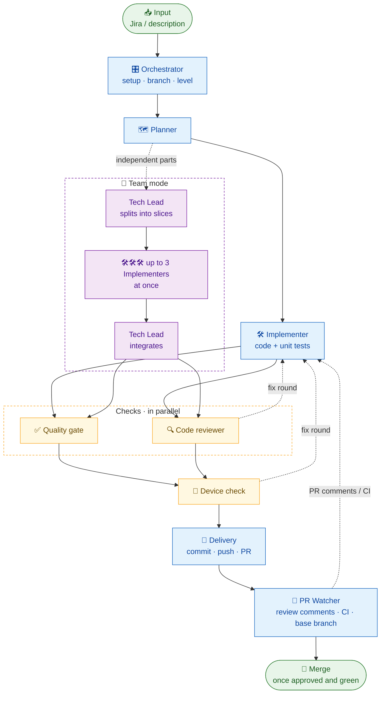
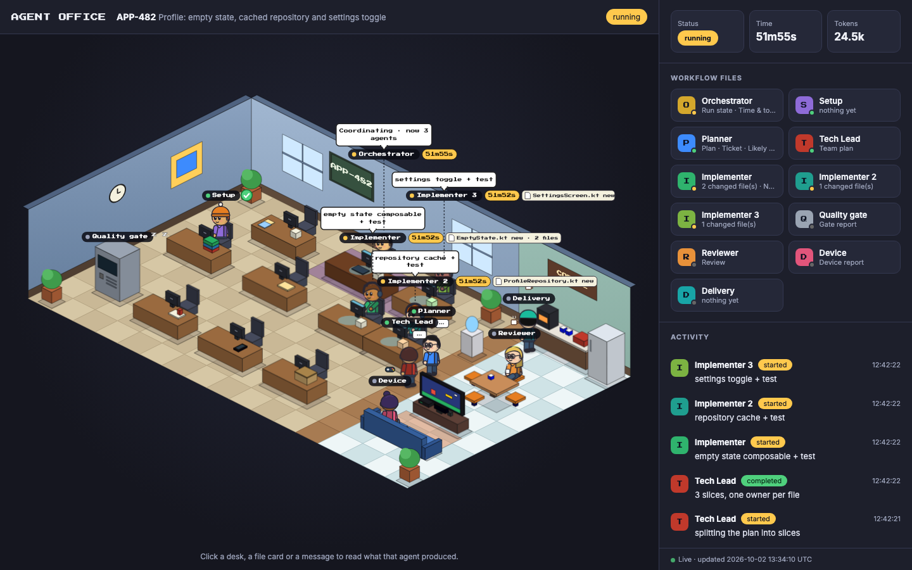
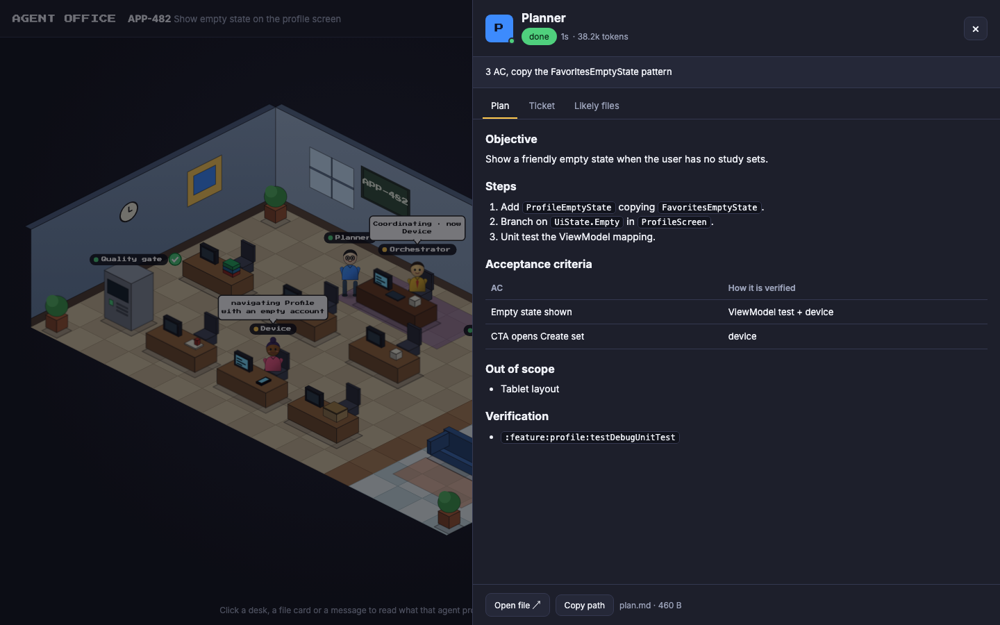

# Android Workflow Kit

A tool-agnostic kit for running Android tickets end to end with coding agents
(Claude Code, Codex, Cursor, Gemini CLI / Antigravity and any
[Agent Skills](https://agentskills.io) host). The agent writes the code; a
standard-library Python CLI detects the project, localizes the change, runs the
quality gate and device checks, and refuses to finish without a real source diff.

**Goal:** a precise PR, fast and cheap to produce.



Every routing decision the run's files can answer (level rules, team or single, fix round or draft, device or skip, CI re-runs) is made by `android-workflow next` in code, not by the agent's reading of prose: see [`decide.py`](tools/android-workflow/android_workflow/decide.py).

The workflow is described in one place: [`skills/android-workflow/SKILL.md`](skills/android-workflow/SKILL.md).
The repository mirrors `~/.ai`, which is where every host reads it from.

## Layout

| Path | What it is |
| --- | --- |
| `.claude/`, `.codex/`, `.cursor/`, `.gemini/`, `.agents/` | Ready-made folders for each tool. They hold only pointers: links to the skills and small agent files that say "read `~/.ai/skills/android-workflow/agents/aw-…md`". |
| `link.sh` | One-time setup: links those folders into your home so every tool finds them. |
| `skills/android-workflow/SKILL.md` | The workflow: stages, agents, levels, stops and delivery rules (single source of truth). |
| `skills/android-workflow/agents/` | The eight `aw-*` agents: setup, planner, tech lead, implementer, reviewer, device, delivery, PR watcher. |
| `skills/device-driving/` | How the Device agent drives the phone or emulator (Maestro first, adb fallback). |
| `skills/android/` | Universal Android skills (Compose, Compose performance, performance, navigation, edge-to-edge, screenshots, Android CLI, ktlint) and `catalog.json`, the topics each one covers. The workflow picks them per ticket. |
| `tools/android-workflow/` | The Python package behind the `android-workflow` CLI, with its tests. |
| `bin/` | `android-workflow` launcher plus the helpers the CLI calls: `feature_setup.py` (project profile), `feature_workspace.py` (ticket branch/worktree) and `android_probe.py`. |

## Install

Requires Python 3.9+ (the `python3` that ships with macOS is enough; standard library only).

```bash
git clone https://github.com/arctouch-douglasfornaro/android-workflow-kit.git ~/.ai
```

Then, once:

```bash
~/.ai/link.sh
```

It links `~/.claude`, `~/.codex`, `~/.cursor`, `~/.gemini` and `~/.agents` to the matching folder in
this kit, enables `multi_agent_v2` in `~/.codex/config.toml` (Codex needs it to spawn agents) and
allows the workflow's commands in `~/.claude/settings.json`.
Anything already there with the same name is moved to `~/.ai-backup/`, never deleted.

Everything points at one source of truth, so edits to the workflow apply at once in every tool. Run
`link.sh` again only when the kit adds or removes an agent or skill.

## Use

### 1. Requirements on your machine

| Needed for | What |
| --- | --- |
| Always | Python 3.9+ (macOS already has it), `git`, and an Android project that builds with Gradle |
| Opening the PR | `gh` (GitHub) or `glab` (GitLab), logged in. Without it you get a link to open the PR by hand. With several GitHub accounts logged in, the one that can see the repository is used (no `gh auth switch`) |
| PR Watcher | `gh`, logged in (GitHub only) |
| Device check | A phone or emulator in `adb devices`, or just an emulator created once in Android Studio (Device Manager): the workflow opens it when nothing is connected. Maestro is installed automatically on first use |
| Jira tickets | A Jira connector (MCP) in your coding tool, so the ticket text is fetched for you |

**Claude Code in auto mode:** `link.sh` also allows the workflow's own commands in
`~/.claude/settings.json` (`Bash(python3 ~/.ai/bin/android-workflow:*)` and
`feature_workspace.py`), so its git steps (commit, push, PR, all done by `CLI deliver`) never wait on a
safety check. It only adds those two rules and keeps a backup of the file.

### 2. Run it

Open the **Android app's folder** in your coding tool and type:

```text
/android-workflow APP-123 Show empty state on the profile screen
```

On Codex use `$android-workflow`. The first argument is the ticket id (a Jira key works); the rest
is the task. That's all: the workflow creates the branch, writes the code and tests, checks
everything and opens the PR.

**Without any flag**, this is what the workflow decides for you. Add a flag at the end of the
command only to change one of them:

| What | Default (no flag) | Flag to change it |
| --- | --- | --- |
| App | The folder your tool is opened in (it must have `settings.gradle`) | `--target PATH` |
| Branch | On `main` (or the repo's base branch): creates `<user>/<TICKET>-<slug>` in the same checkout. On any other branch: keeps working on it | `--worktree` to work in a separate folder instead |
| PR base | The repo's default branch (`origin/HEAD`, else `main`, `master` or `develop`) | `--base BRANCH` |
| Depth | Chosen from the ticket: `express` for a small, clear change (no Planner); `full` for risky areas (lifecycle, migrations, payments, auth); `standard` otherwise. Bugs are never `express` | `--level express\|standard\|full` |
| Device check | Runs when the change is visible or runtime. No device connected: it opens your emulator (the AVD in `device.avd` of `.ai/android-workflow.json`, else the first one) and closes it at the end; a device you connected or opened is never closed. No emulator at all: skipped, and the PR says it was not verified on a device | `--no-device` to always skip it |
| Delivery | Commits, pushes and opens the PR (a draft if some check is still failing) | `--no-pr`, `--no-push` or `--no-commit` to stop earlier |
| After the PR | The PR Watcher follows it until it is merged (below) | `--no-watch` to stop at the PR |

### 3. What happens

1. **Branch** — on the base branch it creates `<user>/<TICKET>-<slug>`; on any other branch it keeps working there.
2. **Setup (first run only)** — learns the project's patterns and quality tools and saves them in `.ai/project-profile.md`. Later tickets reuse it.
3. **Depth** — picks `express`, `standard` or `full` from the ticket (see *Depth* in the table above).
4. **Planner** — reads the code and writes verifiable acceptance criteria. Meanwhile the emulator boots (when no device is connected) and the unchanged app is built in the background.
5. **Implementer** — reads the Android skills this ticket needs (picked automatically: your app's own skills first, e.g. its Compose or testing rules, then the kit's), writes the change and the unit tests that prove it. In parallel, if a device is connected, the **before** screenshots are captured.
   When the plan has independent parts (different modules, data and UI) the **Tech Lead** splits it into slices, up to
   **3 Implementers** build them at the same time, each owning its own files, and the Tech Lead integrates them before the gate.
6. **Quality gate** — formatter, compile, unit tests, detekt and lint for the modules touched. Failures go back to the Implementer (up to 2 times).
7. **Code reviewer** — an independent review of the diff: bugs, side effects, callers, duplication, project conventions. Blocking findings go back to the Implementer once.
8. **Device check** — installs the app, navigates to the change and captures the **after** screenshots or video.
9. **PR** — commits only app code, pushes and opens the PR.
10. **PR Watcher** — follows the PR until it is merged. See below.

You see one line per stage in the chat, e.g. `Reviewer: approved, 0 blocking → review.json`.

### 4. What you get

- **A PR, every time code was written.** Ready for review when every check passed; a **draft** that
  lists what is still open when a check kept failing (gate, review or device). The commit and PR
  carry no tool or AI attribution and follow the repo's PR template when there is one.
- **Before/after evidence** in `.ai/workflow/<TICKET>/media/before/` and `media/after/`, plus
  `media/compare.md`. Drag them into the PR.
- **A log of the run** in `.ai/workflow/<TICKET>/stage-log.md`, with time and tokens per stage in
  `stage-metrics.json` to spot what was slow or expensive.

Everything under `.ai/workflow/` stays on your machine; it is git-ignored and never committed.

### 5. After the PR: the PR Watcher

Once the PR is open the workflow keeps following it, so you only add the reviewers you want:

- **Review comments** (people and review bots such as Cursor Bugbot): it reads each new one with the
  code it points at. A question gets an answer on the PR; a valid point becomes a fix round
  (Implementer → gate → delta review → device only when something visible changed), pushed as a new
  commit, and the thread gets a reply saying what changed and in which commit. It **answers but never
  resolves** threads: resolving is the reviewer's call. A product decision or a disagreement it cannot
  settle with the code comes to you in the chat; nothing is posted for it. Your own comments on the PR
  are left alone.
- **CI**: a failing check is read (the GitHub Actions log, or the same Gradle task run locally) and
  called *ours* (fixed), *flaky* (re-run once) or *unrelated* (fails without this change).
- **Base branch**: when the base moves on or conflicts, it merges the base in (never a rebase or a
  force-push); conflicts go to the Implementer and the gate before the push.
- **Merge**: when every reviewer you requested approved, nobody still asks for changes and the
  required checks passed, it merges with the repository's own method, inside its branch protection.
  With no reviewer requested it merges once green and open for 30 minutes, so a reviewer you add
  right after the PR opens is not raced. A draft never merges.

To watch a PR that is already open: `/android-workflow APP-123 --watch` (add `--pr 22307` when the
branch is not checked out). It runs as long as the session is open, up to 72 hours. Per project, in
`.ai/android-workflow.json`:

```json
{"watch": {"auto_merge": true, "require_review": false, "unreviewed_merge_after_minutes": 30,
           "merge_method": null, "max_rounds": 6, "max_hours": 72, "bots": []}}
```

`require_review: true` always waits for an approval; `auto_merge: false` stops at "ready to merge";
`merge_method` forces `squash`, `merge` or `rebase`; `bots` lists bots whose top-level comments
should be answered too (their inline comments always are).

### 6. Watch the agents work

The workflow keeps a page that shows the run as an isometric office, Habbo style: one desk per agent
(plus the Tech Lead and extra Implementers when a team works), a corridor and a coffee room. Only the agents doing work sit at their desk; the others follow a
deterministic routine — coffee, a chat in the corridor, the console in front of the TV, the window,
a game at their desk —
and walk back as soon as they get work. It is **live**: each working agent's clock counts second by
second next to its name, the file the Implementer is editing shows up on its line (and in its
**Live changes** tab, with lines added and removed) as soon as it is saved, and new activity lands in
the chat within a couple of seconds, without reloading the page or closing the panel you are reading.
Tokens are live too: a working agent's count so far (a pulsing dot next to it) is read from the host's
own transcript — Claude Code (`~/.claude/projects/…/subagents/`) and Codex (`~/.codex/sessions/`) —
using the same number the host reports when the agent returns. Cursor and Gemini write no per-agent
token log, so there the count appears when the agent's stage is logged. `ANDROID_WORKFLOW_NO_USAGE=1`
turns the reading off.
The page also shows who sent work back for a fix, time and tokens per agent and the run's activity as
a chat. It is **one office for every app and run**: a **Project** selector (worktrees count as their
repository) and a **Workflow** selector (running runs first, then past ones) switch the office in place,
and the address keeps the run (`#run=…`) so a reload or a bookmark reopens it. **Click any desk,
agent, file card or message** to read what that agent produced, formatted: the plan and acceptance
criteria, the implementation notes and changed files, every quality-gate check (with the Gradle
logs), the review's blocking points and suggestions, the device report with before/after
screenshots (side by side or with a slider), and the PR description.





The link appears in the chat when a run starts and again in the final summary, always as the
same line, `🏢 **Office:** file:///…`, written by the CLI (not worded by the agent); `start` and
`status` also print it last in their own output. Cmd+click it in the terminal and the office opens
at that run. To open it yourself:

```bash
python3 ~/.ai/bin/android-workflow office                 # every app and run
python3 ~/.ai/bin/android-workflow office --target .      # at this app's current run
python3 ~/.ai/bin/android-workflow office --prune [--days 30]   # forget removed worktrees (and old runs)
```

It is a local file (`~/.local/state/android-workflow/office/office.html`, or `$ANDROID_WORKFLOW_OFFICE_HOME`);
no server, nothing leaves your machine. Each app's `.ai/workflow/office.html` only opens it at that app's
run. While a run is live a small background process keeps it current between commands; it stops by
itself when the run ends. A run stays listed after its worktree is removed until `office --prune`;
`clean` in an app removes its runs from the office too.

### 7. When it stops to ask you

It only stops **before writing code**, when it would otherwise have to guess: a business rule the
ticket does not define, a bug without steps to reproduce it, or a project fact Setup could not find.
Answer in the chat and it continues.

### 8. Cleaning up old runs (optional)

Each run leaves its files (plan, notes, log, screenshots) in `.ai/workflow/<TICKET>/` inside the app.
They never go to git, but they pile up, one folder per ticket. From the app's folder:

```bash
python3 ~/.ai/bin/android-workflow list  --target .                    # which tickets have run here
python3 ~/.ai/bin/android-workflow clean --target . --ticket APP-123   # delete one ticket's files
python3 ~/.ai/bin/android-workflow clean --target .                    # delete them all
```

The project profile (`.ai/project-profile.md`) is kept, so the next run does not redo Setup.

### 9. Updating the kit

If you installed with `git clone`, run `git -C ~/.ai pull` to get the newest version. Every tool
uses it at once; nothing else to do.

More: the full workflow rules are in [`skills/android-workflow/SKILL.md`](skills/android-workflow/SKILL.md)
and the CLI reference in [`tools/android-workflow/README.md`](tools/android-workflow/README.md).

## Tests

```bash
cd ~/.ai/tools/android-workflow && python3 -m unittest discover -s tests
cd ~/.ai/bin && python3 -m unittest discover -p '*_test.py'
```
