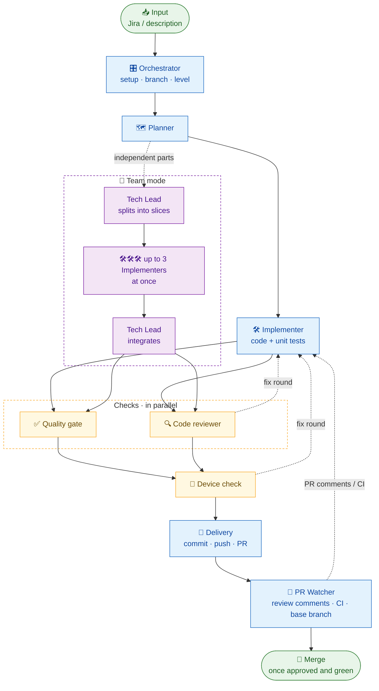
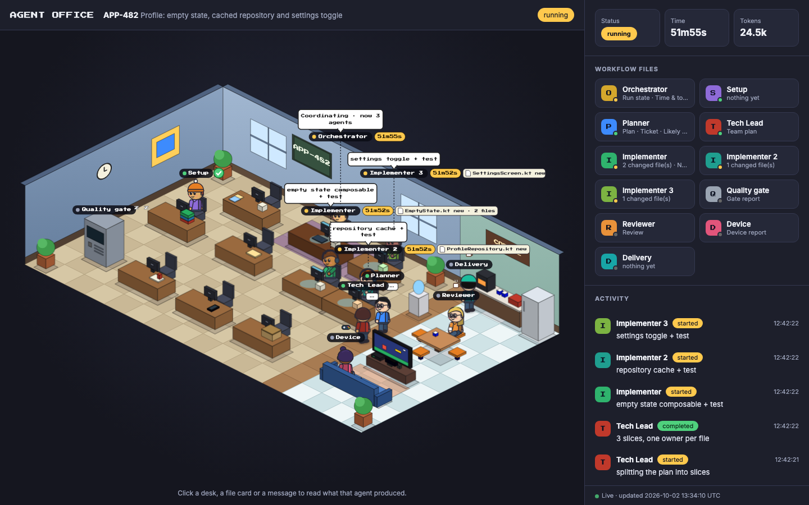
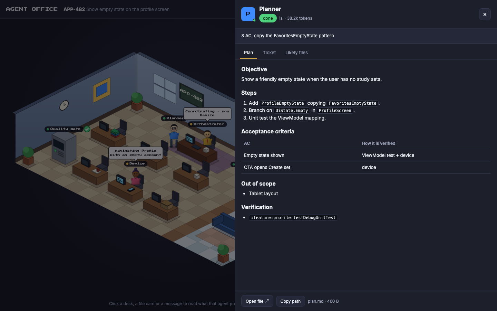

# Android Workflow Kit

A tool-agnostic kit for running Android tickets end to end with coding agents
(Claude Code, Codex, Cursor, Gemini CLI / Antigravity and any
[Agent Skills](https://agentskills.io) host). The agent writes the code; a
standard-library Python CLI detects the project, localizes the change, runs the
quality gate and device checks, and refuses to finish without a real source diff.

**Goal:** a precise PR, fast and cheap to produce.



Every routing decision the run's files can answer (level rules, team or single, fix round or draft, device or skip, CI re-runs) is made by `android-workflow next` in code, not by the agent's reading of prose: see [`decide.py`](tools/android-workflow/android_workflow/decide.py).

The workflow is described in one place: [`skills/android-workflow/SKILL.md`](skills/android-workflow/SKILL.md).
The repository mirrors `~/.ai`, which is where every host reads it from.

## Layout

| Path | What it is |
| --- | --- |
| `.claude/`, `.codex/`, `.cursor/`, `.gemini/`, `.agents/` | Ready-made folders for each tool. They hold only pointers: links to the skills and small agent files that say "read `~/.ai/skills/android-workflow/agents/aw-…md`". |
| `link.sh` | One-time setup: links those folders into your home so every tool finds them. |
| `skills/android-workflow/SKILL.md` | The workflow: stages, agents, levels, stops and delivery rules (single source of truth). |
| `skills/android-workflow/agents/` | The nine `aw-*` agents: setup, planner, tech lead, implementer, reviewer, device, media, delivery, PR watcher. |
| `skills/device-driving/` | How the Device agent drives the phone or emulator (Maestro first, adb fallback). |
| `skills/android-bug-triage/` | Bug triage: reproduces a reported bug on the device, finds the cause and drafts the ticket, then hands the run to `/android-workflow`. |
| `skills/investigate-first/` | Finding the cause of a bug or crash before editing: symptom, traced path, ranked hypotheses, cause with `file:line` or the blocker. |
| `skills/create-ticket/` | Writes a ticket (title, description, acceptance criteria, tech detail) as text; filing it in a tracker is a separate step. |
| `skills/android/` | Universal Android skills (Compose, Compose performance, performance, navigation, edge-to-edge, screenshots, Android CLI, ktlint) and `catalog.json`, the topics each one covers. The workflow picks them per ticket. |
| `tools/android-workflow/` | The Python package behind the `android-workflow` CLI, with its tests. |
| `bin/` | `android-workflow` launcher plus the helpers the CLI calls: `feature_setup.py` (project profile), `feature_workspace.py` (ticket branch/worktree) and `android_probe.py`. |
| `skills/eval-playbook/`, `evals/`, `bin/skill_eval.py` | Evals for the agents' instructions: cases on a synthetic app, checks, a Codex judge and a score history. |
| `AGENTS.md` | Rules for coding agents working on this kit (run the evals after changing an agent). |

## Install

Requires Python 3.9+ (the `python3` that ships with macOS is enough; standard library only).

```bash
git clone https://github.com/arctouch-douglasfornaro/android-workflow-kit.git ~/.ai
```

Then, once:

```bash
~/.ai/link.sh
```

It links `~/.claude`, `~/.codex`, `~/.cursor`, `~/.gemini` and `~/.agents` to the matching folder in
this kit, enables `multi_agent_v2` in `~/.codex/config.toml` (Codex needs it to spawn agents) and
allows the workflow's commands in `~/.claude/settings.json`.
Anything already there with the same name is moved to `~/.ai-backup/`, never deleted.

Everything points at one source of truth, so edits to the workflow apply at once in every tool. Run
`link.sh` again only when the kit adds or removes an agent or skill.

## Use

### 1. Requirements on your machine

| Needed for | What |
| --- | --- |
| Always | Python 3.9+ (macOS already has it), `git`, and an Android project that builds with Gradle |
| Opening the PR | `gh` (GitHub) or `glab` (GitLab), logged in. Without it you get a link to open the PR by hand. With several GitHub accounts logged in, the one that can see the repository is used (no `gh auth switch`) |
| PR Watcher | `gh`, logged in (GitHub only) |
| Device check | A phone or emulator in `adb devices`, or just an emulator created once in Android Studio (Device Manager): the workflow opens it when nothing is connected. Maestro is installed automatically on first use |
| Jira tickets | A Jira connector (MCP) in your coding tool, so the ticket text is fetched for you |

**Claude Code in auto mode:** `link.sh` also allows the workflow's own commands in
`~/.claude/settings.json` (`Bash(python3 ~/.ai/bin/android-workflow:*)` and
`feature_workspace.py`), so its git steps (commit, push, PR, all done by `CLI deliver`) never wait on a
safety check. It only adds those two rules and keeps a backup of the file.

### 2. Run it

Open the **Android app's folder** in your coding tool and type:

```text
/android-workflow APP-123 Show empty state on the profile screen
```

On Codex use `$android-workflow`. The first argument is the ticket id (a Jira key works); the rest
is the task. That's all: the workflow creates the branch, writes the code and tests, checks
everything and opens the PR.

**Without any flag**, this is what the workflow decides for you. Add a flag at the end of the
command only to change one of them:

| What | Default (no flag) | Flag to change it |
| --- | --- | --- |
| App | The folder your tool is opened in (it must have `settings.gradle`) | `--target PATH` |
| Branch | On `main` (or the repo's base branch): creates `<user>/<TICKET>-<slug>` in the same checkout. On any other branch: keeps working on it | `--worktree` to work in a separate folder instead |
| PR base | The repo's default branch (`origin/HEAD`, else `main`, `master` or `develop`) | `--base BRANCH` |
| Depth | Chosen by code: `express` for a look-only change (a color, text, size or icon on at most 2 files): no Planner, no new test, a lighter review and one render or screenshot with no extra build; `full` for risky areas (lifecycle, migrations, payments, auth); `standard` otherwise. Bugs are never `express` | `--level express\|standard\|full` |
| Device check | Runs when the change is visible or happens at runtime (audio and analytics events too, from the filtered logcat). It opens an emulator for the run: `device.avd` first (a name or a list), then phones before tablets. No emulator at all: skipped, and the PR says so | `--no-device` to always skip it |
| Delivery | Commits, pushes and opens the PR (a draft if some check is still failing) | `--no-pr`, `--no-push` or `--no-commit` to stop earlier |
| After the PR | The PR Watcher follows it until it is merged (below) | `--no-watch` to stop at the PR |

### 3. What happens

1. Branch: on the base branch it creates `<user>/<TICKET>-<slug>`; on any other branch it keeps working there.
2. Setup, first run only: learns the project's patterns and quality tools and saves them in `.ai/project-profile.md`. Later tickets reuse it.
3. Depth: `express`, `standard` or `full`, from the ticket (see the table above).
4. Planner: reads the code and writes verifiable acceptance criteria. The unchanged app builds in the background in its own checkout, so the device can capture the before state.
5. Implementer: writes the change and the unit tests that prove it, following the Android skills the ticket needs (your app's own first). When the plan has independent parts, a Tech Lead splits it and up to 3 Implementers build the slices at once.
6. Quality gate: formatter, compile, unit tests, detekt and lint for the touched modules. Failures go back to the Implementer, up to 2 times.
7. Code reviewer: an independent review of the diff (bugs, side effects, callers, duplication, project conventions), in parallel with the gate. Blocking findings go back once.
8. Device check: installs the app, reaches the change with Maestro flows and captures the after screenshots or video, paired with the before. A check that left a criterion unverified, or saw something odd, is PARTIAL and you choose: ready, draft or another round.
9. PR: commits only app code, pushes and opens the PR.
10. PR Watcher: follows the PR until it is merged (below).

The chat gets one line per stage, e.g. `Reviewer: approved, 0 blocking → review.json`.

Two tickets at once work too: run each with `--worktree` in its own session. The CLI shares build
slots (`execution.max_parallel_builds`, default 2) and gives each run its own emulator, up to
`device.max_emulators`. By default (`device.dedicated: true`) runs only use emulators the workflow
started, never the emulator you opened or your phone; `false` lets them. With 3 or more runs on one
laptop, keep 2 build slots or fewer and close Android Studio. Details: [`docs/cli-decisions.md`](docs/cli-decisions.md).

### 4. What you get

- A PR every time code was written: ready for review when every check passed, or a draft listing what
  is still open. It follows the repo's PR template and carries no tool or AI attribution unless the
  project sets `{"attribution": {"enabled": true}}` in `.ai/android-workflow.json` (the CLI then adds
  the host's `Generated with` line, and a `Co-Authored-By` trailer on Claude Code).
- Before/after evidence in `.ai/workflow/<TICKET>/media/`, with the PR template's Before/After table
  filled in. Nothing is uploaded: drag the files into the PR.
- A log in `.ai/workflow/<TICKET>/stage-log.md`, with time and tokens per stage in `stage-metrics.json`.

Everything under `.ai/workflow/` stays on your machine and is git-ignored.

Static UI (layout, colors, texts, empty, error, dark or RTL states) can be proved by a JVM render in
1 to 3 minutes instead of a device run: Robolectric draws the composable in the unit-test JVM. It
stays off until Setup's `CLI render probe` passes in the module, and the CLI picks render, device or
both per acceptance criterion. `CLI render prefer --mode device` turns it off.

### 5. After the PR: the PR Watcher

Once the PR is open the workflow keeps following it:

- Review comments, from people and bots: a question gets an answer on the PR; a valid point becomes a
  fix round (Implementer, gate, delta review, device only when something visible changed), pushed as
  a new commit, and the thread gets a reply saying what changed. It answers threads but never resolves
  them. A product decision or a disagreement the code cannot settle comes to you in the chat.
- CI: a failing check is classified as ours (fixed), flaky (re-run once) or unrelated.
- Base branch: when the base moves or conflicts, it merges the base in, never a rebase or force-push.
- Merge: once approved, nobody still asking for changes and the required checks green, it merges with
  the repository's method, inside branch protection. A draft or a stacked PR never merges.

To watch a PR that is already open: `/android-workflow APP-123 --watch` (add `--pr 22307` when the
branch is not checked out). The `watch` keys in `.ai/android-workflow.json` (`auto_merge`,
`require_review`, `merge_method`, `max_hours`, `bots`) are in the [CLI reference](tools/android-workflow/README.md).

To watch **all** your open PRs, run `/android-workflow` (or `/android-workflow --watch`) with no ticket in
the app's main checkout. It is a listener: each of your open PRs in this repository gets its own tab
running `/android-workflow <ID> --watch --pr N`, in the checkout of the PR's branch (a new `wt-<branch>`
worktree when none has it), until the PR is merged. A PR another session already watches is left
alone, PRs you open later get their tab too, and a tab you close stays closed until you start the
listener again. Forks are reported, never checked out; drafts are watched unless `watch.inbox.drafts`
is `false`. Tabs open with the `review.inbox` terminal and agent settings.

### 6. Watch the agents work

Each run has a live page that shows the agents as an office: one desk per agent, its clock and tokens,
the file the Implementer is editing and the run's activity as a chat. Click a desk to read what that
agent produced: the plan, the gate's checks, the review, the device report with before/after
screenshots, the PR description. One page covers every app and run.





The link appears in the chat when a run starts and in the final summary (`🏢 **Office:** file:///…`).
To open it yourself:

```bash
python3 ~/.ai/bin/android-workflow office                 # every app and run
python3 ~/.ai/bin/android-workflow office --target .      # at this app's current run
python3 ~/.ai/bin/android-workflow office --prune [--days 30]   # forget removed worktrees (and old runs)
```

It is a local file; nothing leaves your machine.


### 7. When it stops to ask you

It only stops **before writing code**, when it would otherwise have to guess: a business rule the
ticket does not define, a bug without steps to reproduce it, or a project fact Setup could not find.
Answer in the chat and it continues.

### 8. Cleaning up old runs (optional)

Each run leaves its files (plan, notes, log, screenshots) in `.ai/workflow/<TICKET>/` inside the app.
They never go to git, but they pile up, one folder per ticket. From the app's folder:

```bash
python3 ~/.ai/bin/android-workflow list  --target .                    # which tickets have run here
python3 ~/.ai/bin/android-workflow clean --target . --ticket APP-123   # delete one ticket's files
python3 ~/.ai/bin/android-workflow clean --target .                    # delete them all
```

The project profile (`.ai/project-profile.md`) is kept, so the next run does not redo Setup.

### 9. Updating the kit

If you installed with `git clone`, run `git -C ~/.ai pull` to get the newest version. Every tool
uses it at once; nothing else to do.

More: the full workflow rules are in [`skills/android-workflow/SKILL.md`](skills/android-workflow/SKILL.md)
and the CLI reference in [`tools/android-workflow/README.md`](tools/android-workflow/README.md).

## Reviewing someone else's PR

```text
/android-review 22307 [--no-watch]  # or the PR URL, from the app's folder
```

Checks the PR out in its own worktree, derives what it claims (PR body, Jira, the PR template's
checked items), reviews the code (architecture, side effects), reads the attached screenshots and
videos, trusts CI when it passed on the PR head (else the local gate) and, when the PR changes UI,
runs the device on the base APK and on the PR head. Then it shows the review it would post
(verdict, at most 10 inline comments, `nit:` for non-blocking ones) and posts it by itself when it
is an APPROVE or COMMENT with every check done (CI, device, each acceptance criterion). A
REQUEST_CHANGES, or anything left unchecked, waits for **your OK**
(`"review": {"auto_post": false}` always asks).
With `attribution` on for the project, the review body ends with the host's `Generated with` line.

After the post it keeps following the PR until it is merged or closed (`--no-watch` stops right
after the post, or say stop at any time):

- New commits: a delta review of only those commits, checking whether our earlier comments were
  addressed. The device and the media check run again only when the commits change UI or the
  attachments changed. When we already approved and nothing new comes up, no second review is posted;
  it only offers to resolve our addressed threads.
- A reply in a thread we took part in, or an @mention: it drafts the answers and posts them after your OK.
- One of our threads settled: it proposes resolving it in the draft you approve.
- A comment you write on the PR by hand is recorded as `missed` in `review-decisions.jsonl`, what the
  review did not catch.

It never resolves another reviewer's thread, never requests changes or posts a partly checked review without your OK, and never
merges. Closing the session stops the watch.

### Listening for review requests

```text
/android-review            # no PR, from the app's main checkout
```

With no PR, `/android-review` reviews nothing itself. It listens for open PRs in this repository
that request **your** review and opens each one in a new Terminal.app or iTerm tab running
`claude -n "review PR-N" "/android-review N"`. Each tab is an ordinary review: it stops at the draft
and posts by itself only a fully checked APPROVE or COMMENT; the rest waits for your OK **in that tab**. With Terminal One, the listener also adds one task per PR
to the board.

- It picks up direct review requests, plus PRs assigned to you. Team requests are off by default.
- It reports drafts, forks, bots (dependabot, renovate, github-actions) and authors outside
  `OWNER`/`MEMBER`/`COLLABORATOR` once and never launches them, because launching builds the PR's code
  on your machine. Start one by hand with `/android-review N`.
- At most 5 reviews run at once (`review.inbox.max_parallel`). Others queue until a slot frees up.
  A session that only watches its PR after the post does not count.
- A PR that asks for your review again after you reviewed it is launched again only when its old
  session has ended (a live session already follows the PR).
- The listener stops when you close its session or say stop. Tabs it launched keep running.

The `review.inbox.*` keys in `.ai/android-workflow.json` change what counts and how tabs open
(`terminal`, `iterm`, or your own `command`); see the
[CLI reference](tools/android-workflow/README.md).

### Were my comments addressed?

Ask "were my comments addressed on PR 22307?" (or "tudo foi addressado?"). The review skill runs
`android-workflow review status`, a read-only check that needs no worktree and works after the
reviewing session is gone. For each thread you opened it reports `addressed`, `open`, `resolved`,
or `resolved_without_change_or_reply` (flagged), plus the commits since your last reviewed head.
With new commits it offers `/android-review 22307` for a delta round. It posts and resolves nothing.

Details: [`skills/android-review/SKILL.md`](skills/android-review/SKILL.md) and the design in
[`docs/android-review-design.md`](docs/android-review-design.md).

## Triaging a bug

```text
/android-bug-triage APP-123          # a Jira or Linear key or link, a stack trace, or a description
```

Before anyone fixes a bug, the triage tells you whether it is real and where it comes from. It reads the
ticket (the tracker is detected from the key or link), builds the base branch in its own checkout and
tries the reported steps on an emulator with a Maestro flow, with a video and the app's filtered logcat.
Then the Planner traces the cause through the code (`file:line`, ranked hypotheses) and plans the fix.
The result goes to `.ai/workflow/<ID>/triage-report.md`, and a comment for the ticket (or a new ticket,
with the `create-ticket` skill) is shown to you and posted only after your OK.

It never writes code. When it found the cause, it offers `/android-workflow <ID>`, which continues the
same run: the plan is ready and the reproduction flow becomes the device proof of the fix. A bug that
does not reproduce ends with what was tried and the questions to ask the reporter. Emails and tokens
are redacted from the report and the draft; reproduce with test accounts only.

## Tests

```bash
cd ~/.ai/tools/android-workflow && python3 -m unittest discover -s tests
cd ~/.ai/bin && python3 -m unittest discover -p '*_test.py'
```

Unit tests cover the CLI, not what the agents do with their instructions. After changing an agent's
`.md` or a workflow `SKILL.md`, ask Claude Code in `~/.ai` to "run the evals" (`/eval-playbook`): it runs
each affected case on a synthetic app, scores it with Codex as the judge and prints the delta against
the last run (`python3 ~/.ai/bin/skill_eval.py report`).
